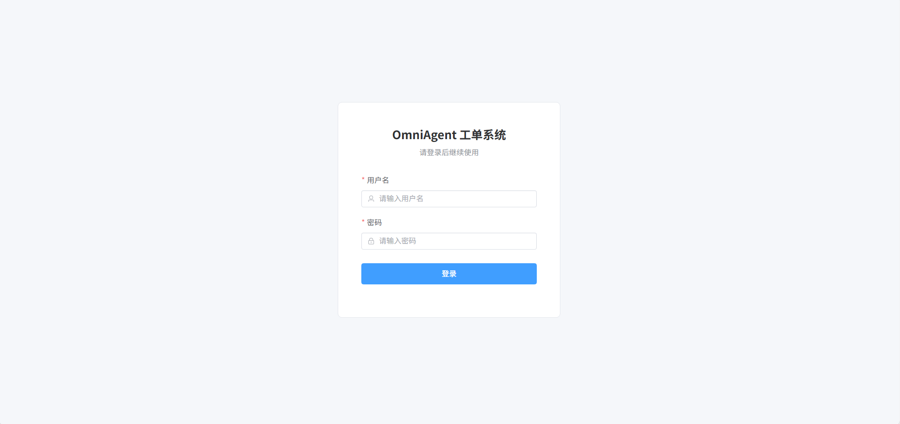
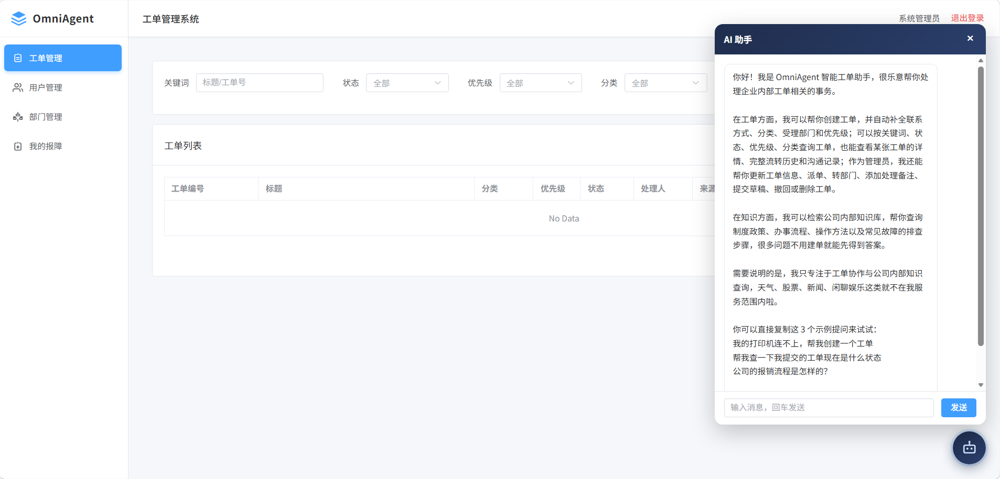
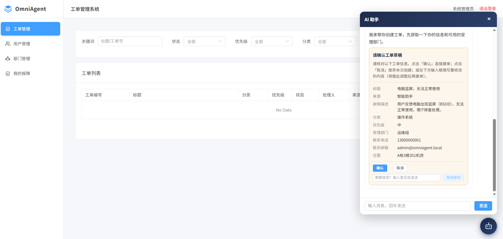
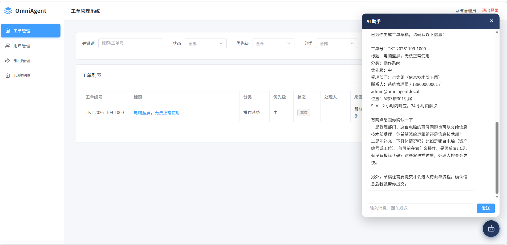
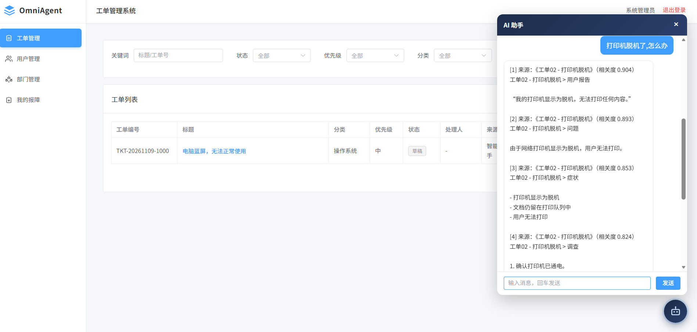
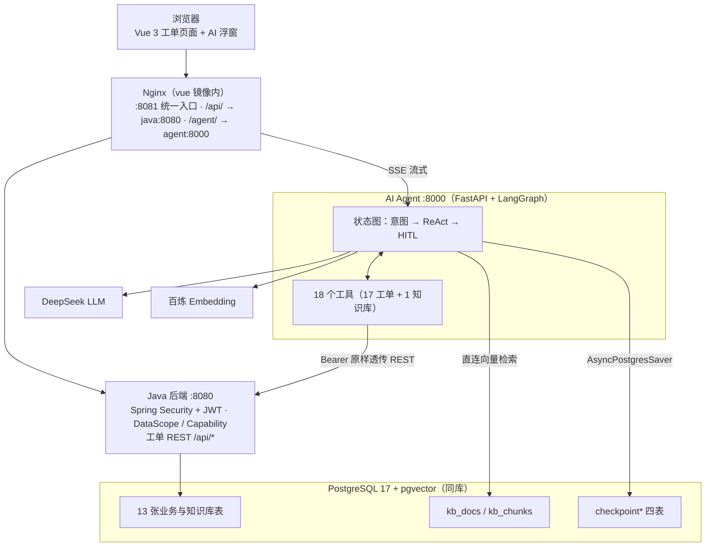
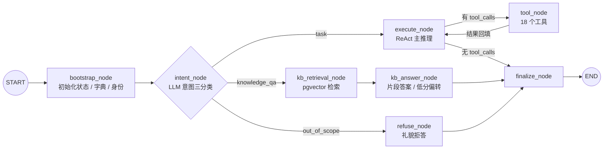

# OmniAgent 智能工单助手

> 基于 **Spring Boot 3 + Vue 3 + FastAPI / LangGraph** 的工单系统，覆盖「报障 → 派单 → 处理 → 解决 → 关闭」闭环；核心是贯穿四种业务角色的 **AI 辅助层**：LLM 意图识别 → ReAct 工具循环（18 个工具）→ 高风险写操作人工确认（HITL）→ SSE 流式输出，业务数据一律经 Java REST 读写。

[](https://openjdk.org/)
[](https://spring.io/projects/spring-boot)
[](https://vuejs.org/)
[](https://fastapi.tiangolo.com/)
[](https://langchain-ai.github.io/langgraph/)
[](https://github.com/pgvector/pgvector)
[](LICENSE)

---

## 项目预览

> 截图来自本机 Docker Compose 部署（统一入口 `http://localhost:8081`），原图见 [`assets/`](assets/)。

**1 · 登录页** — JWT 无状态认证的入口。



**2 · 唤起 AI 助手** — 打开浮窗即返回能力介绍与示例问题，并声明职责边界（天气、股票、新闻、闲聊不处理）。



**3 · 高风险写操作人工确认（HITL）** — 建单前由工具内 `interrupt()` 挂起图，前端渲染结构化确认卡：标题、来源、报障描述、分类、优先级、受理部门、联系电话、位置；可确认、取消或补充意见后再提交。



**4 · AI 辅助建单** — 确认后生成工单草稿，自动补全工单号、受理部门、优先级、SLA、位置等字段，工单列表出现「草稿」记录，AI 继续追问需补充的信息。



**5 · 知识库问答** — 问「打印机脱机了怎么办」，走 RAG 旁路返回带来源与相关度的分片答案（《工单02 - 打印机脱机》，相关度 0.904 / 0.893 / 0.853 / 0.824）及排查步骤，不编造内容。



---

## 一、快速开始

### 1.1 环境要求

- Windows / macOS：**Docker Desktop**；Linux：**Docker Engine + `docker-compose-plugin`**。
- **无需本机 JDK / Node / Python**。
- 两把外部 Key：**DeepSeek**（LLM）、**阿里云百炼 DashScope**（1024 维 embedding）。缺密钥时工单功能可用，AI 助手不可用。

### 1.2 拉取预构建镜像，一键启动

```bash
git clone https://github.com/Eny-O/omniagent.git
cd omniagent
cp .env.example .env
# 编辑 .env：填 DEEPSEEK_API_KEY、DASHSCOPE_API_KEY；JWT_SECRET 必须 ≥ 32 字节（openssl rand -hex 32）
docker compose pull java agent vue
docker compose up -d
```

三个应用镜像由 CI 预构建发布在 GHCR。正常输出为 `Pull complete`；出现 `Building ...` 时执行 `docker compose pull java agent vue`。完整变量清单见 `.env.example`；改了源码用 `docker compose up -d --build`。

```bash
docker compose logs -f agent     # Agent 启动日志
docker compose ps                # 四个服务状态
docker compose down              # 停止（保留数据卷）
```

### 1.3 数据库初始化

数据卷为空的**首次启动**自动按文件名顺序执行 `sql/01_schema.sql` → `sql/02_init_data.sql` → `sql/03_demo_kb.sql`：建 13 张表、索引、`ticket_no_seq` 序列，写入 7 状态 / 3 优先级 / 10 分类 / 5 来源 / 6 部门 / 5 个登录账号，导入 20 篇示范知识库文档与 240 个向量。三个脚本都可重复执行（`IF NOT EXISTS` / `ON CONFLICT DO NOTHING`），**不含演示工单与会话状态**。`checkpoint*` 四表由 Agent 启动时自建。详见 [`sql/README.md`](sql/README.md)。

### 1.4 默认账号

密码统一为 `123456`。对外部署前改密并替换 `users.password_hash` 哈希。

| 用户名 | 角色 | 说明 |
| --- | --- | --- |
| `admin` | ADMIN | 全量数据范围，可硬删工单 |
| `zhangsan` / `zhaoliu` | REPORTER | 报障人 |
| `lisi` | HANDLER | 处理人 |
| `wangwu` | SUPERVISOR | 主管，可派单 |

### 1.5 常用访问地址

| 地址 | 说明 |
| --- | --- |
| `http://localhost:8081` | **统一入口**（Nginx：前端 + `/api/` + `/agent/` 同源，`WEB_PORT` 可改） |
| `http://localhost:8081/agent/healthz` | Agent 健康检查（经 Nginx 剥前缀） |
| `http://localhost:5173` | 本机开发模式的前端 Vite 地址 |
| `http://localhost:8000/healthz` | 本机开发模式的 Agent 健康检查 |

远程部署时把 `localhost` 换成服务器 IP，并放行 `WEB_PORT`（见 1.7）。

### 1.6 只起数据库 / 本机开发

```bash
docker compose up -d postgres          # 只起库，三端本机跑，保留热更新
cd omniagent-java && mvn spring-boot:run
cd omniagent-agent/OmniAgent && pip install -r requirements.txt && uvicorn app.main:app --host 0.0.0.0 --port 8000
cd omniagent-vue/omniagent && npm ci && npm run dev
```

本机开发启动前设置 `SPRING_DATASOURCE_PASSWORD`，或参照 [`application.yml.example`](omniagent-java/src/main/resources/application.yml.example) 创建本地配置。

### 1.7 在 Linux 服务器上部署

```bash
curl -fsSL https://get.docker.com | sudo sh      # 安装 Docker Engine 与 Compose v2 插件
sudo usermod -aG docker $USER && newgrp docker   # 当前用户加入 docker 组
docker compose version                           # 确认 Compose v2

git clone https://github.com/Eny-O/omniagent.git
cd omniagent && cp .env.example .env
# 填 DEEPSEEK_API_KEY / DASHSCOPE_API_KEY；JWT_SECRET 用 openssl rand -hex 32 生成
docker compose pull java agent vue
docker compose up -d
```

- **远程访问**：浏览器打开 `http://<服务器IP>:8081`；放行端口（`sudo ufw allow 8081/tcp` 或 `firewall-cmd --add-port=8081/tcp --permanent`），云服务器在控制台安全组放行。
- **SELinux（RHEL / Rocky / CentOS）**：postgres 日志报 permission denied 时执行 `sudo chcon -Rt svirt_sandbox_file_t ./sql`。
- **端口冲突**：5432 被占用时改 `.env` 的 `POSTGRES_PORT`。
- **arm64 主机**：使用 CI 发布的双架构镜像（amd64 / arm64）。

## 二、项目架构



三端共用一套 PostgreSQL：Java 独占业务表，Agent **只直连 KB 向量表与 checkpoint 四表**，工单一律经 Java REST 读写。身份链路是 **JWT 纯 Bearer**：Java 签发 → 前端携带 → Agent 验签得到 `uid/role` → 工具把同一个 Bearer 原样透传给 Java → 由 Java 的 DataScope（能看哪些）+ Capability（能做哪些）做最终裁决。

系统只有 4 个业务角色：`REPORTER` 报障人、`HANDLER` 处理人、`SUPERVISOR` 主管、`ADMIN` 管理员。**AGENT 不进角色枚举、不拥有工单、不被分配**——它是叠加在业务角色之上的智能辅助层，以当前登录者的身份调用后端，后端授权永远只针对业务角色。

---

## 三、Agent 架构：LangGraph 图编排



| 节点 | 职责 |
| --- | --- |
| `bootstrap_node` | 幂等预热字典与 KB 连接池；同一 `thread_id` 的 System 提示词只加一次；缓存 `(user_id, role, bearer)` |
| `intent_node` | LLM 输出 `{"intent", "reason"}`，分类失败或非法值一律兜底 `task` |
| `execute_node` ⇄ `tool_node` | ReAct 循环；LLM 调用异常在节点内兜底，不穿透到图外 |
| `kb_retrieval_node` → `kb_answer_node` | 知识问答旁路，不进工单流程；带 `RetryPolicy(max_attempts=2)` |
| `refuse_node` | 职责外请求固定话术拒答，不触发任何工具 |
| `finalize_node` | 取最后一条消息作为 `response` 收口 |

意图分三路：`task` 进 ReAct 工具循环、`knowledge_qa` 走知识库旁路、`out_of_scope` 直接拒答，分类失败一律兜底 `task`。高风险写操作由工具内部 `interrupt()` 挂起图，前端确认后以 `Command(resume=...)` 续跑；中断状态由 PostgreSQL Checkpointer 按 `thread_id` 持久化。

`stream_mode=["messages", "custom"]`：messages 通道按 `langgraph_node == "execute_node"` 过滤后才是用户可见的打字机文本（避免意图分类的内部 JSON 泄露进气泡），custom 通道下发节点中间状态。实现见 `omniagent-agent/OmniAgent/app/services/agent_service.py`。

---

## 四、技术栈

| 层 | 技术 |
| --- | --- |
| 后端 | Spring Boot 3.2.5 · JDK 17 · MyBatis-Plus 3.5.16 · Spring Security + JJWT 0.12.6（无状态 Bearer）· Knife4j 4.4.0 |
| **AI Agent** | FastAPI 0.138 · Python 3.12 · **LangGraph 1.2 / LangChain 1.4** · DeepSeek `deepseek-v4-flash` · 百炼 `qwen3.7-text-embedding` |
| Agent 基础设施 | `AsyncPostgresSaver`（PG Checkpointer）· `psycopg` / `asyncpg` 连接池 · SSE（`StreamingResponse`） |
| 数据 | PostgreSQL 17 + pgvector（13 张业务与知识库表 + 工单号序列；另有 4 张 checkpoint 表由 Agent 启动时自建） |
| 前端 | Vue 3.5 · Vite 8 · TypeScript · Element Plus · Axios · `AgentChatFab.vue` 浮窗 |
| 部署 | Docker Compose · Nginx 1.27 同源反代 · GHCR 预构建镜像 · GitHub Actions 多架构构建 |

## 五、仓库结构

三端共存于同一仓库，各自独立构建、独立镜像、独立部署。

```
omniagent/                               # 仓库根
├── README.md
├── LICENSE
├── docker-compose.yml                   # postgres + java + agent + vue
├── .env.example                         # 配置样例
├── .github/workflows/images.yml         # CI：构建并推送三端镜像到 GHCR
├── sql/
│   ├── 01_schema.sql                    # 13 张表 + 索引 + ticket_no_seq
│   ├── 02_init_data.sql                 # 字典 / 部门 / 5 个默认账号
│   ├── 03_demo_kb.sql                   # 20 篇示范文档 + 240 个向量
│   └── README.md
├── omniagent-java/                      # Spring Boot 后端  :8080
│   ├── Dockerfile                       # maven:3.9-temurin-17 多阶段构建
│   └── src/main/java/com/wj/omniagent/
│       ├── common/                      # security / context / enums / config
│       ├── modules/ticket/              # 工单：controller / service / mapper / enums
│       └── modules/user/                # 用户、认证、部门
├── omniagent-agent/OmniAgent/           # FastAPI + LangGraph  :8000
│   ├── Dockerfile                       # python:3.12-slim
│   ├── requirements.txt                 # 19 个直接依赖（版本锁定）
│   ├── langgraph.json                   # LangSmith / LangGraph 独立测图入口
│   └── app/
│       ├── main.py                      # lifespan 预热、CORS、/healthz
│       ├── api/agent.py                 # SSE 接口、JWT 验签、请求契约
│       ├── services/agent_service.py    # 状态图、意图、ReAct、Checkpointer
│       ├── prompts/system.py            # 按角色拼装的系统提示词
│       ├── tools/                       # ticket_tools.py / kb_tool.py / 注册表
│       ├── kb/                          # embedding / retrieval / ingestion
│       ├── repositories/                # backend_client.py（调 Java 的唯一出口）
│       ├── core/                        # config.py / database.py
│       ├── schemas/ · models/ · utils/  # 数据结构、JWT、调试输出
└── omniagent-vue/omniagent/             # Vue 3 前端 + Nginx  :80
    ├── Dockerfile                       # node:22 构建 → nginx:1.27
    ├── nginx.conf                       # /api/ → java:8080，/agent/ → agent:8000
    └── src/
        ├── views/agent/AgentChatFab.vue # AI 浮窗、确认卡、SSE 渲染
        ├── api/agent.ts                 # 流式请求与恢复
        └── views/{ticket,user,department,login,index}/
```

## 六、注意事项

- **必填密钥**：在 `.env` 填 `DEEPSEEK_API_KEY`、`DASHSCOPE_API_KEY`；`JWT_SECRET` 用 `openssl rand -hex 32` 生成（≥ 32 字节），对外部署时更换示例值。修改 `.env` 后执行 `docker compose up -d --force-recreate java agent`。
- **端口**：默认 Web `8081`、PostgreSQL `5432`；被占用时改 `.env` 的 `WEB_PORT` / `POSTGRES_PORT` 后重新启动，浏览器访问 `http://localhost:<WEB_PORT>`。
- **数据**：停止服务用 `docker compose down`；不要用 `docker compose down -v`（会清空数据库）。
- **演示账号**：5 个账号共用口令 `123456`，数据库 `postgres/postgres`；对外部署前改密并更换 JWT 密钥，不要提交含密钥的 `.env`。

## 七、说明

本项目为个人学习与作品展示用途。架构决策围绕一条主线展开：**把 AI 做成贯穿业务角色的辅助层，而不是新的权限主体**——智能负责理解意图、补全信息、编排工具，权限与数据一致性始终由 Java 后端兜底，写操作则交由人工确认把关。

## License

[The Unlicense](LICENSE)（public domain）。
